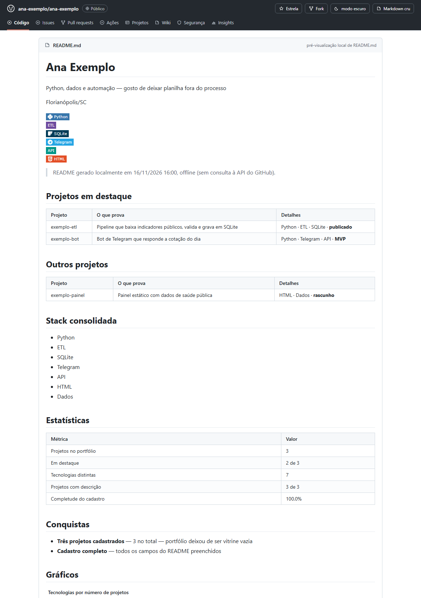
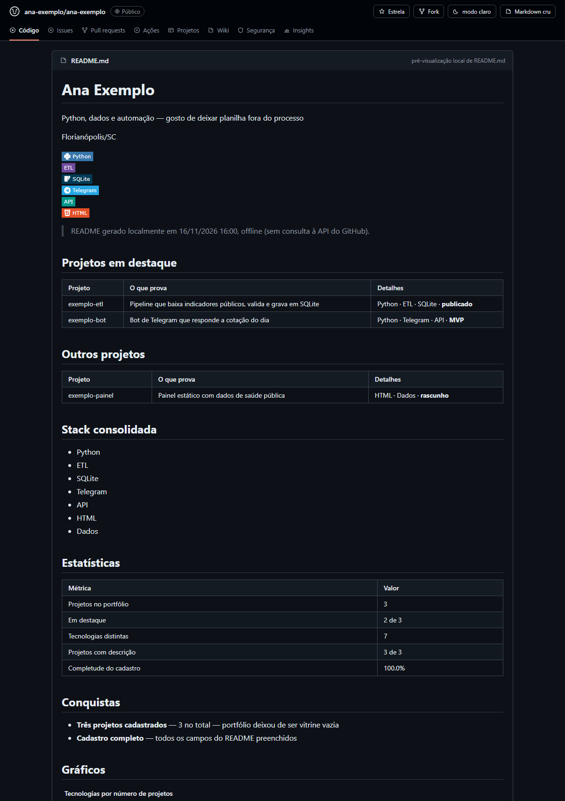
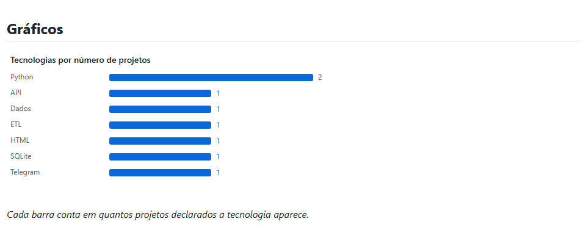
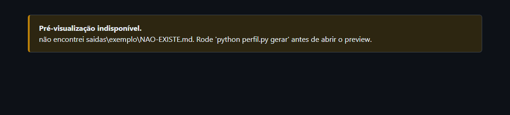
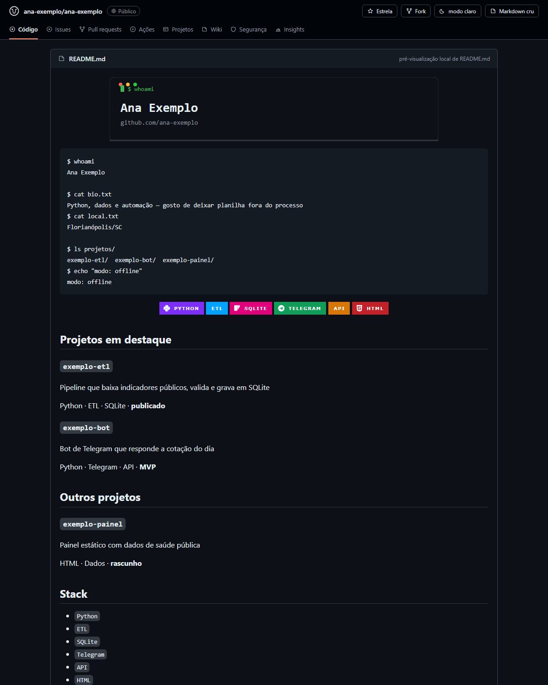

# PerfilAdaptativo

[](https://www.python.org/)
[](LICENSE)


Um gerador de README de perfil que serve a **qualquer pessoa**, não só a uma: você
responde algumas perguntas, ele confere os dados, desenha os gráficos e mostra o
resultado **no seu navegador** — igual à página do GitHub. Só depois de **duas
aprovações** o arquivo pode ser enviado para o GitHub.

O problema real: portfólio bom morre de desatualização. Link quebrado, data velha,
projeto que não existe mais. Aqui a curadoria é local, a publicação é um passo
consciente e o programa se recusa a gravar senha, token ou chave.

## Classificação

| Campo | Descrição |
|---|---|
| **Propósito** | Transformar os dados de um perfil em README verificável, com pré-visualização local e publicação em dois aceites. |
| **Maturidade** | MVP local e funcional: coleta, validação, geração, gráficos, visualizador com tema claro/escuro, aprovação dupla e upload. |
| **O que está sendo treinado** | Qualidade de dados, Python sem dependência pesada, integração com API pública, escrita de programa testável. |
| **Quem usaria** | Quem mantém perfil no GitHub e quer um README que não minta; quem ensina a montar portfólio; quem quer laboratório de automação com Python. |

## Metodologia Loop

Este projeto nasceu do repositório base [`projeto_loop`](https://github.com/Georgebecker/projeto_loop)
e anda em ciclos: **hipótese → mudança pequena → teste → métrica → ACEITO/REJEITADO**.
Cada ciclo está em [`meu-loop-agente/log.md`](meu-loop-agente/log.md); as decisões que
não são óbvias pelo código estão em [`NOTES.md`](NOTES.md).

Não é projeto de "achismo": cada funcionalidade tem teste automatizado e o número
que aparece no relatório é medido do dado, nunca estimado.

## O que tem aqui

- **Coleta guiada** — `iniciar` pergunta nome, bio e links; **lê a conta pública do
  GitHub** e já traz os repositórios, deixando você confirmar quais entram. Recusa, no
  ato, resposta com cara de senha ou chave.
- **Importação do GitHub** — `importar` baixa os dados públicos do seu usuário
  (nome, bio, site, repositórios) e mescla com o que você já escreveu, sem apagar nada.
- **Duas rotas para a data de atualização** — a API do GitHub quando há cota; o feed de
  commits quando a cota acaba (60/h sem token). A data fica guardada no perfil, então
  `gerar --offline` continua mostrando a data real.
- **Validação com laudo** — erros bloqueiam, avisos informam, completude é medida em %.
- **README que começa zerado e cresce** — perfil novo gera um documento enxuto e
  honesto; cada projeto, stack ou link novo aparece na geração seguinte.
- **Gráficos em SVG** — desenhados pelo próprio Python, sem internet e sem
  biblioteca gráfica; o GitHub exibe como imagem e eles trocam de cor no tema escuro.
- **Visualizador local** — imita a página de repositório do GitHub (marca, abas,
  estrela, fork, ícones) e troca entre **tema claro e escuro com um clique**.
- **Três templates visuais** — `minimal`, `dark-terminal` e `animated`, com o
  catálogo validado em `config/templates.yaml` antes de gerar.
- **Dupla aprovação** — duas etapas amarradas ao SHA-256 de README + perfil + gráficos;
  mudou uma vírgula, as aprovações caem.
- **Publicação explícita** — só depois dos dois aceites e com `--confirmar`; o token
  vive na variável de ambiente, nunca em arquivo.

```text
perfil.py                     porta de entrada (subcomandos)
generate.py                   gerador do formato de curadoria (mesma montagem)
perfil_adaptativo/
  seguranca.py                barreira: recusa senha, token e chave
  modelo.py                   formato do perfil, normalização e validação
  coleta.py                   entrevista interativa
  importacao.py               dados públicos do GitHub
  analise.py                  pipeline: valida, classifica e mede
  graficos.py                 SVG de barras e banners, sem dependência
  render.py                   Markdown a partir dos dados já mastigados
  gerador.py                  linha de montagem única dos dois comandos
  templates_visuais.py        catálogo, menu e validação de template
  preview.py                  servidor local + tema claro/escuro + ícones
  aprovacao.py                dupla aprovação e upload
config/templates.yaml         catálogo dos visuais
templates/
  minimal/profile.md.j2       visual limpo (padrão)
  dark-terminal/profile.md.j2 visual terminal
  animated/profile.md.j2      visual animado
examples/perfil.exemplo.yaml  perfil fictício para testar sem rede
data/processed/               perfil e aprovações (fora do git)
saidas/                       README, gráficos e relatório gerados (fora do git)
```

## Como rodar

Requisitos: Python 3.11 ou superior.

```bash
python -m venv .venv
source .venv/bin/activate        # Windows: .venv\Scripts\activate
pip install -r requirements.txt
```

O caminho completo, do zero ao publicado:

```bash
python perfil.py iniciar                  # pergunta os dados, lê sua conta do GitHub e já gera
python perfil.py importar --github seu-usuario   # reimporta só o que o GitHub sabe
python perfil.py validar                  # confere e mostra o que falta
python perfil.py gerar --offline          # README + gráficos em saidas/
python perfil.py preview --abrir          # http://127.0.0.1:8765 (tema em 1 clique)
python perfil.py aprovar --etapa 1        # dados revisados
python perfil.py aprovar --etapa 2        # texto final aprovado
python perfil.py publicar --confirmar     # envia README + gráficos ao GitHub
```

> **Projetos:** você não precisa digitar os repositórios que já estão públicos no
> GitHub — `iniciar` lê a conta e mostra a lista numerada para você confirmar (ou
> escolher quais entram). `--sem-importar` desliga essa leitura; `--max N` limita
> quantos repositórios são oferecidos.

Testar sem tocar na rede, com o perfil fictício:

```bash
python perfil.py gerar --perfil examples/perfil.exemplo.yaml --saida saidas/exemplo --offline
python perfil.py preview --perfil examples/perfil.exemplo.yaml --saida saidas/exemplo --html saidas/exemplo/preview.html
pytest -q
```

Guia detalhado, com o que cada comando faz e o que ele nunca faz:
[`docs/COMO_USAR.md`](docs/COMO_USAR.md).

## Templates visuais

Três visuais prontos, escolhidos por `--template`. O catálogo fica em
[`config/templates.yaml`](config/templates.yaml) e é validado **antes** da geração
— pedir um visual inexistente dá erro com a lista dos válidos, nunca arquivo vazio.

| id | visual | quando usar |
|---|---|---|
| `minimal` | tabelas e listas, sem enfeite | quem quer só o dado |
| `dark-terminal` | banner de terminal, badges fortes, bloco `console` | quem gosta da estética dev |
| `animated` | cabeçalho centralizado, banner animado, cartões em citação | quem quer destaque visual |

```bash
python perfil.py gerar --template dark-terminal
python generate.py --offline --template animated
```

Sem `--template`, um terminal interativo mostra o menu numerado; um script usa o
padrão `minimal` e imprime o aviso no log. Todos os visuais recebem o **mesmo
contexto**: trocar de template muda a arrumação, nunca o dado.

## Licenças de Terceiros

Os três templates são desenho original deste projeto (MIT). As referências de
estilo e o status de licença de cada uma estão em
[`THIRD_PARTY_NOTICES.md`](THIRD_PARTY_NOTICES.md) — inclusive o caso em que a
licença de origem **não** pôde ser confirmada e, por isso, nenhum material foi
reutilizado.

## 🖼️ O que você vê antes de publicar

O visualizador local imita a página de repositório do GitHub — cabeçalho, abas, estrela,
fork — e mostra o seu `README.md` renderizado de verdade, com tema claro e escuro em um
clique.



*Este é o primeiro contato: `usuario/usuario`, selo "Público", botões Estrela/Fork, o
botão de tema e as abas de repositório. Abaixo, o README com badges, tabelas, stack e
gráfico.*



*O mesmo conteúdo, um clique depois: só as cores mudam. O gráfico SVG acompanha o tema.*



*Cada barra conta em quantos projetos a tecnologia aparece. Número medido do perfil,
nunca estimado; o gráfico é SVG gerado pelo próprio Python.*



*Abrir a pré-visualização antes de gerar devolve 404 com instrução, não stack trace.*



*Um dos três templates visuais (`--template dark-terminal`): banner de terminal, bloco
`console` com `whoami` e badges fortes.*

As outras quatro telas (Markdown cru, estado vazio, template `animated` e tela estreita)
estão em [`docs/TELAS.md`](docs/TELAS.md), com legenda de cada uma.

## 🚀 Convite à interação

**Iniciante:** clone, rode o exemplo offline e tente melhorar uma mensagem de erro —
é o jeito mais rápido de entender o projeto. Abra um Pull Request pequeno; eu reviso
e explico o que mudou. Tarefas marcadas com `good first issue` são para começar.

**Colega de programação:** se encontrar gargalo, brecha de segurança ou uma decisão
de arquitetura que envelheceu mal, abra uma Issue. Gosto especialmente de discussão
sobre validação de dado, porque é onde quase todo gerador de documento erra.

**Recrutador ou visitante:** este é projeto real, com testes, log de decisões e
limitações declaradas. O código está aqui; o histórico de ciclos está em
[`meu-loop-agente/log.md`](meu-loop-agente/log.md).

## Transparência e limitações

- **O visualizador imita o GitHub, não é o GitHub.** Abas, estrela e fork são
  ilustrativos: ensinam onde cada coisa fica, mas não são clicáveis.
- **As capturas são do Chrome headless em ambiente Windows.** Outro navegador pode
  espaçar tabela e badge de forma levemente diferente; o HTML é o mesmo.
- **A API do GitHub tem limite de 60 consultas por hora sem token.** Com doze
  projetos, cabe; com muitos, defina `GITHUB_TOKEN` (só para consultar, não é preciso
  para gerar em modo `--offline`).
- **Status do projeto nunca é deduzido.** A API não sabe se algo está publicado, em
  MVP ou rascunho; quando você não declara, o README diz "não declarado".
- **Publicação é só do README e dos gráficos.** `--repo` aceita outro repositório,
  mas o caminho padrão é o repositório de perfil (`usuario/usuario`), que precisa
  existir e ter o mesmo nome do usuário.
- **Aprovação não é assinatura criptográfica.** O registro local usa SHA-256 para
  detectar mudança de conteúdo; quem tem acesso à máquina pode alterar o registro.
  Serve contra erro e esquecimento, não contra sabotagem.

## Apoio

O código é livre (MIT): use, copie, mude e redistribua. Se quiser retribuir, a
melhor forma é abrir uma Issue apontando um problema ou mandar um Pull Request
pequeno — e dizer onde o guia travou para você.

## Topics do repositório

```text
python, readme-generator, github-profile, data-quality, local-first,
svg, markdown, portfolio, loop-engineering, pytest
```
