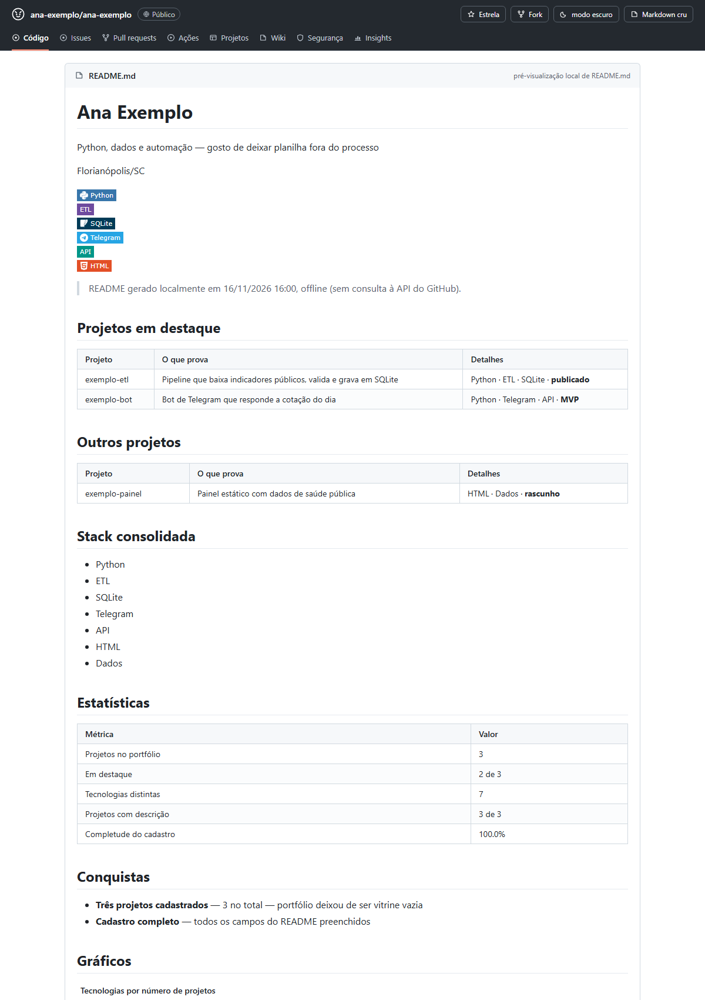
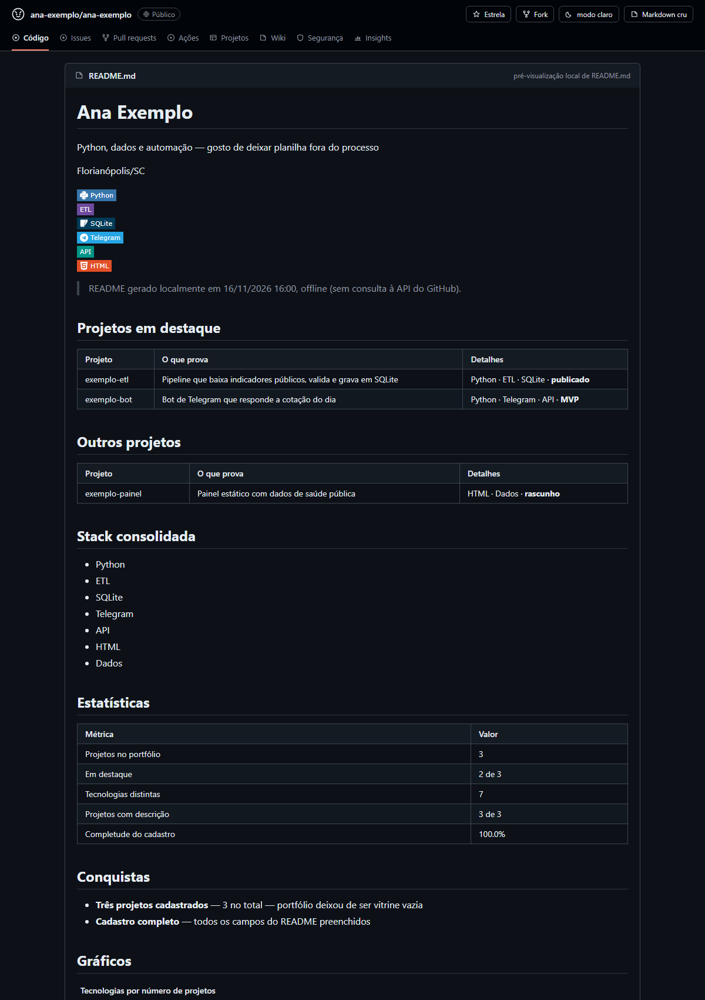
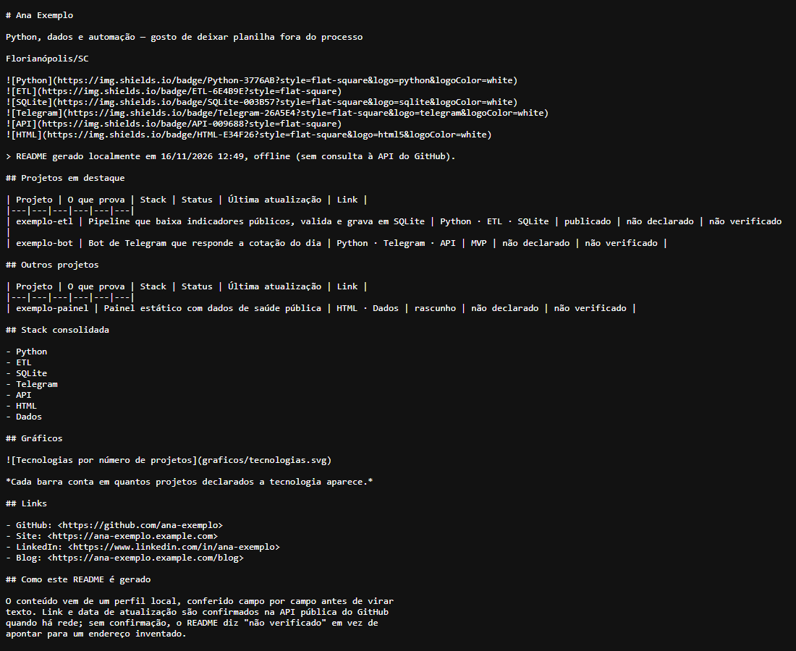
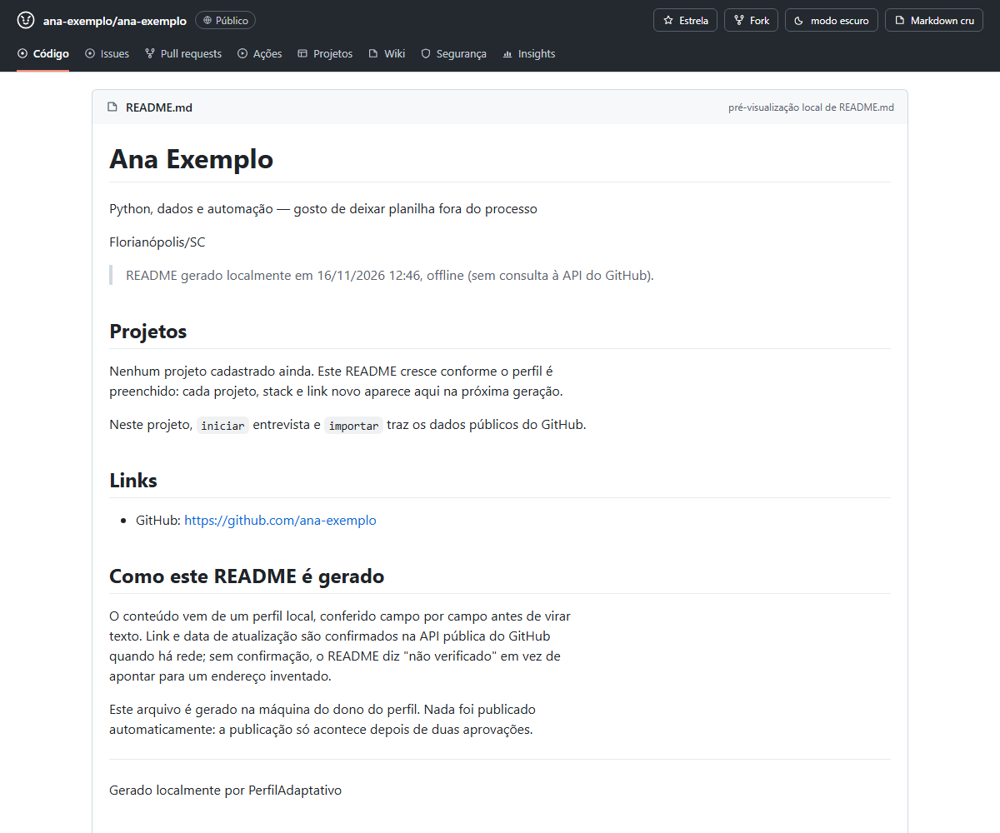
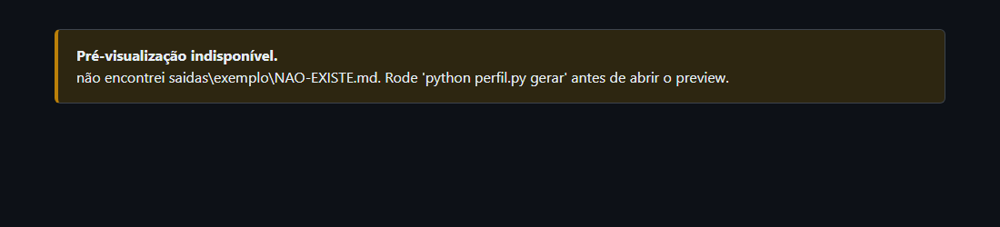
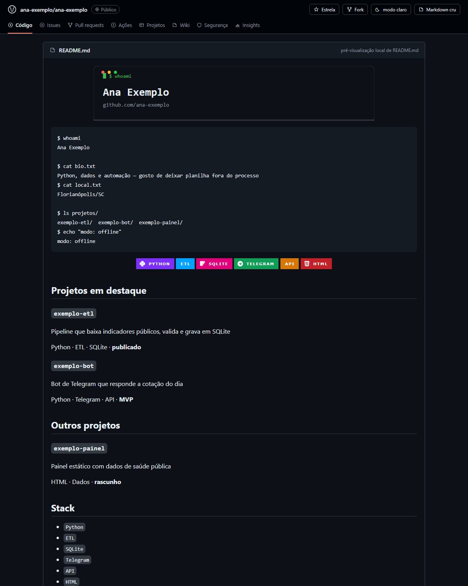
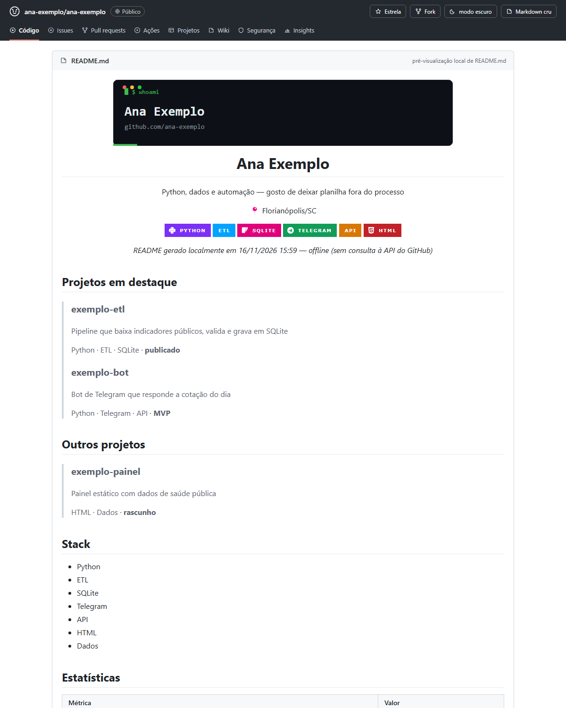
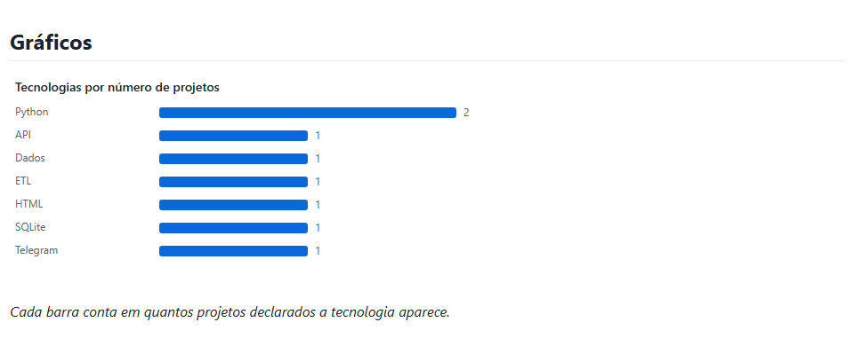
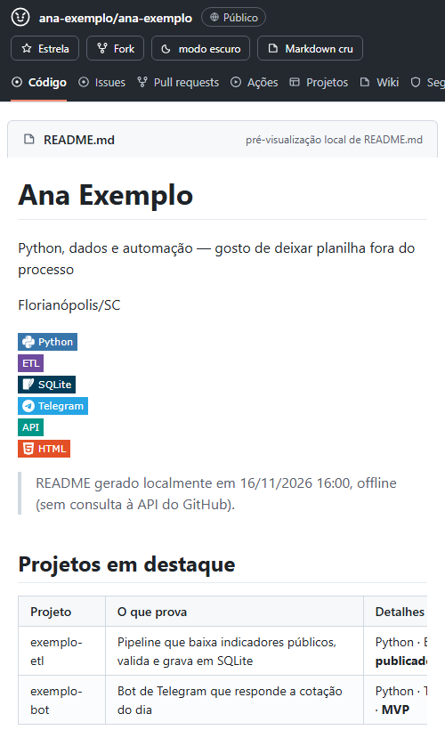

# Telas do PerfilAdaptativo

Todas as capturas são do **visualizador local** (`python perfil.py preview`), rodando
com o perfil fictício `examples/perfil.exemplo.yaml`. Nada foi montado à mão: cada
imagem é o que o navegador renderiza a partir do `README.md` gerado.

Método: Chrome em modo headless, `--window-size` fixo, sem edição de conteúdo. Duas
imagens foram recortadas (o gráfico e nada mais) para não gastar espaço com área vazia.

## Índice

| # | Arquivo | O que mostra |
|---|---|---|
| 1 | `01-visual-claro.png` | Página inteira no tema claro |
| 2 | `02-visual-escuro.png` | O mesmo conteúdo no tema escuro |
| 3 | `03-markdown-cru.png` | A rota `/raw`, com o Markdown puro |
| 4 | `04-readme-zerado.png` | Estado vazio: perfil sem projeto |
| 5 | `05-erro-amigavel.png` | Erro explicado, sem stack trace |
| 6 | `06-template-dark-terminal.png` | Template `dark-terminal` |
| 7 | `07-template-animated.png` | Template `animated` |
| 8 | `08-graficos.png` | Gráfico com números reais |
| 9 | `09-visual-estreito.png` | Tela estreita (celular) |

## 1. Visualizador no tema claro



*Este é o primeiro contato: cabeçalho com marca, `ana-exemplo/ana-exemplo`, selo
"Público", botões Estrela/Fork, o botão "modo escuro" e as abas do repositório. Abaixo,
o `README.md` renderizado com badges, duas tabelas (coluna "Detalhes" reúne stack,
estágio e data), a stack, as seções **Estatísticas** e **Conquistas** e o gráfico. O
botão diz "modo escuro" porque o tema atual é o claro — o rótulo informa o que o
clique faz.*

## 2. Visualizador no tema escuro



*O mesmo conteúdo, um clique depois (ou abrindo `?tema=escuro`). Nada de dado muda:
só as cores. Texto, tabelas, código, estatísticas e gráfico acompanham o tema —
inclusive o gráfico SVG, que tem `prefers-color-scheme` no próprio desenho.*

## 3. Markdown cru



*A rota `/raw` devolve o arquivo exatamente como está no disco: tabelas em pipe,
badges como ``, links em `<>`. Serve para conferir que o que o navegador
mostra é o que o GitHub vai receber.*

## 4. Estado vazio



*Primeira geração, com um perfil sem projetos. Em vez de erro, o README sai enxuto e
explica que cresce: cada projeto, stack e link novo aparece na próxima geração. É o
"começa zerado" do projeto — honesto em vez de vazio.*

## 5. Erro amigável



*Abrir a pré-visualização antes de gerar o README devolve HTTP 404 com uma caixa
explicando o que fazer ("Rode 'python perfil.py gerar'"), e não uma página em branco
nem um stack trace.*

## 6. Template `dark-terminal`



*O mesmo perfil com `--template dark-terminal`: banner SVG no formato de janela de
terminal, bloco `console` com `whoami`/`cat bio.txt`/`ls projetos/`, badges largas e
cada projeto em bloco com descrição, stack, estágio e data — sem texto de "não
declarado": campo vazio simplesmente não aparece.*

## 7. Template `animated`



*O visual `animated`: banner com cursor piscando e barra que percorre a base, título
centralizado, badges coloridos e projetos em cartões. O banner é SVG gerado por
`perfil_adaptativo/graficos.py`; não existe imagem de terceiro no caminho.*

## 8. Gráfico com números reais



*Recorte da seção "Gráficos". Cada barra conta em quantos projetos declarados a
tecnologia aparece — Python em 2, as demais em 1. O número vem do perfil, não de uma
estimativa; o arquivo é `saidas/exemplo/graficos/tecnologias.svg`, versionado como
texto e exibido pelo GitHub como imagem.*

## 9. Tela estreita



*Em 500 px, o cabeçalho quebra em duas linhas e a tabela de seis colunas ganha rolagem
própria, em vez de arrastar a página inteira para o lado. Foi esta captura que
revelou o defeito: antes, a tabela esticava o documento e cortava o texto.*

## Como capturar de novo

```powershell
# 1. gere o exemplo e suba o servidor
python perfil.py gerar --perfil examples/perfil.exemplo.yaml --saida saidas/exemplo --offline
python perfil.py preview --perfil examples/perfil.exemplo.yaml --saida saidas/exemplo

# 2. capture (Chrome headless; o Edge serve do mesmo jeito)
& "C:\Program Files\Google\Chrome\Application\chrome.exe" `
  --headless=new --disable-gpu --hide-scrollbars `
  --window-size=1200,1700 `
  --screenshot="docs\img\01-visual-claro.png" `
  "http://127.0.0.1:8765/?tema=claro"
```

Telas de template usam o `.html` autônomo (`preview --html ... --tema claro`), e o
estado vazio usa `examples/perfil.zerado.yaml` (perfil sem projetos, versionado justamente
para a captura ser reproduzível).

## Regras respeitadas

- Nenhuma captura tem token, chave, e-mail, telefone ou caminho com nome de usuário.
- As imagens são do estado aprovado pelos testes (67 verdes no momento da captura).
- Nenhuma tela foi simulada fora do que o código produz.
